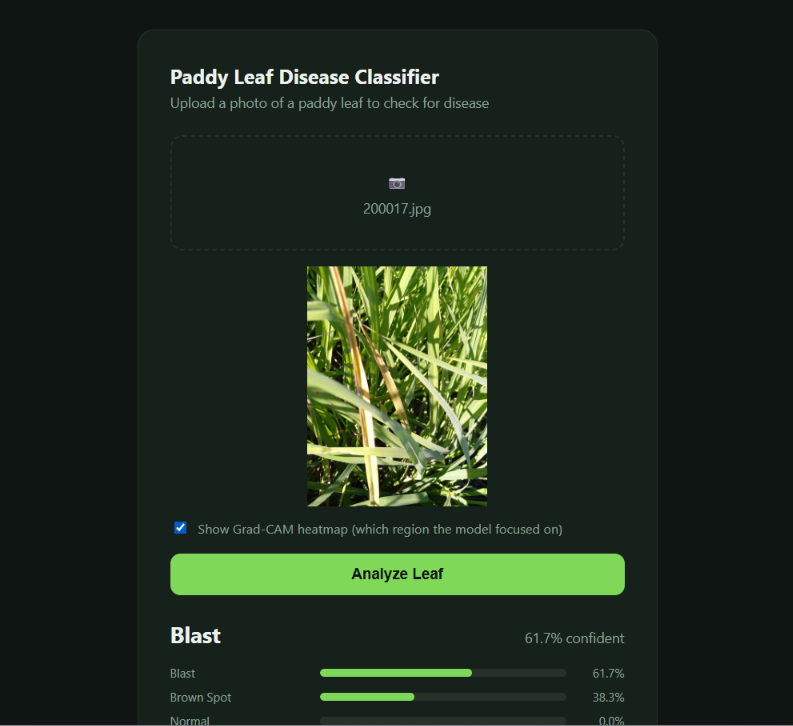
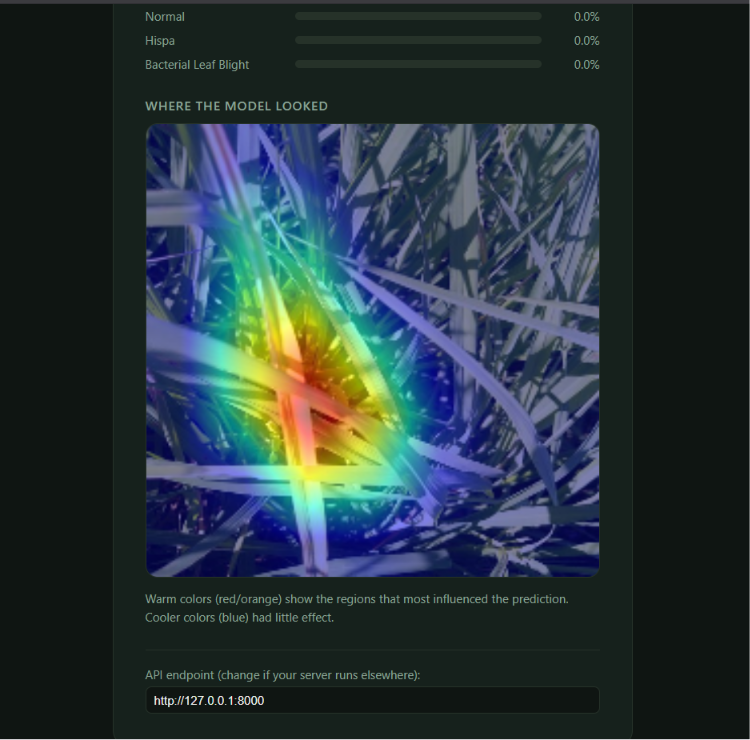

# Paddy Leaf Disease Classifier — Field-Condition Robustness Study

A computer vision project that classifies paddy (rice) leaf diseases from
real field photos, with a specific focus on measuring and improving how well
a model holds up under degraded, real-world image conditions (blur, poor
lighting, shadows, noise) rather than just reporting a single accuracy
number on clean validation data.

## The problem this addresses

Most plant-disease classifiers report high accuracy on clean, well-lit,
well-framed validation images and stop there. In practice, a farmer's photo
taken on a phone in the field is rarely that clean — it may be blurry,
poorly lit, partially shadowed, or noisy. A model that looks excellent on
paper can fail badly the moment it meets a real, imperfect photo. This
project explicitly tests for that gap and measures whether a more
field-realistic training strategy actually closes it.

## Dataset

- **Paddy Doctor** — a field-condition rice leaf disease dataset collected
  in Tirunelveli, Tamil Nadu, via smartphone camera.
- Subset used: **5 classes** — `bacterial_leaf_blight`, `blast`,
  `brown_spot`, `hispa`, `normal` (out of the 10 available in the full
  dataset).
- Stratified 70/15/15 train/val/test split, done per-class to preserve
  class balance across splits.

## Method

1. **Baseline model**: EfficientNet-B0 (ImageNet-pretrained, fine-tuned),
   trained with light augmentation (flips, rotations only).
2. **Field-adapted model**: the same architecture, trained with heavier,
   field-realistic augmentation (motion blur, shadow simulation,
   brightness/contrast shifts, coarse dropout, hue/saturation jitter).
3. **Robustness stress test**: both models were evaluated on the same
   held-out test images in two conditions — the original clean images, and
   synthetically corrupted versions (motion blur + reduced brightness +
   cast shadows + sensor noise stacked together, simulating a genuinely
   poor-quality field photo).
4. **Explainability**: Grad-CAM was used to visualize which regions of the
   leaf each model attended to when making a prediction, both as a
   standalone analysis tool and live inside the demo app.

## Results

| Metric | Light augmentation | Heavy (field-realistic) augmentation |
|---|---|---|
| Validation accuracy (during training) | 97.7% | 96.9% |
| Clean test accuracy (75-image sample) | 94.7% | **96.0%** |
| Corrupted test accuracy (same images, synthetically degraded) | 45.3% | **57.3%** |
| **Accuracy drop under corruption** | **49.3 points** | **38.7 points** |

**Headline finding**: the field-realistic augmentation strategy improved
accuracy on *both* clean and corrupted images, and specifically reduced the
robustness gap by roughly **11 percentage points** compared to standard
light augmentation — despite scoring slightly lower on validation accuracy
during training. This shows that validation accuracy alone can be a
misleading signal of real-world readiness, and that augmentation strategy
matters more for deployment robustness than for the benchmark number.

### Notable patterns observed
- `brown_spot` was the most robust class for both models — the majority of
  `brown_spot` test images remained correctly classified even after
  corruption.
- Under corruption, misclassifications from other classes disproportionately
  landed on `hispa` or `normal` for both models, suggesting these two
  classes have more visually generic features that other classes get
  conflated with under noise/blur.
- Grad-CAM visualizations on correct predictions show the models correctly
  concentrating on the diseased plant structure (e.g. panicle/lesion area)
  rather than background foliage — supporting evidence that the model is
  learning genuine disease features rather than spurious background cues.

## Demo

A minimal web demo lets you upload a leaf photo and see:
- The predicted disease class and confidence
- A full probability breakdown across all 5 classes
- A live Grad-CAM heatmap showing which part of the image most influenced
  the prediction

**Prediction with confidence breakdown:**


**Live Grad-CAM heatmap:**


## Project structure

```
paddy-disease-classifier/
├── data/
│   ├── raw/paddy_doctor/          # original Kaggle download
│   ├── processed/field/           # train/val/test split, 5 classes
│   └── corrupted_samples/         # example corrupted images for reference
├── src/
│   ├── config.py                  # paths, hyperparameters, class list
│   ├── data_prep.py                # stratified train/val/test split script
│   ├── dataset.py                  # PyTorch Dataset + augmentation pipelines
│   ├── train.py                    # training loop (run via Colab GPU)
│   ├── evaluate.py                 # accuracy / confusion matrix / metrics
│   ├── gradcam.py                  # standalone Grad-CAM visualization tool
│   ├── compare_models.py           # side-by-side model comparison on test images
│   └── corruption_test.py          # the core robustness stress-test experiment
├── models/
│   ├── best_model_field_light.pth
│   └── best_model_field_heavy.pth
├── demo/
│   ├── api.py                      # FastAPI server (/predict, /predict-with-gradcam)
│   └── frontend/
│       └── index.html              # browser-based demo UI
├── notebooks/
│   └── paddy_training_colab.ipynb  # Colab notebook used for GPU training
├── reports/
│   └── gradcam/                    # saved Grad-CAM overlay images
└── README.md
```

## Setup

```bash
pip install torch torchvision opencv-python albumentations scikit-learn grad-cam fastapi uvicorn python-multipart
```

### 1. Get the data

Download the Paddy Doctor competition dataset from Kaggle (free, requires
accepting competition rules once):
```bash
kaggle competitions download -c paddy-disease-classification -p data/raw/paddy_doctor
unzip data/raw/paddy_doctor/paddy-disease-classification.zip -d data/raw/paddy_doctor
```

### 2. Prepare the data split
```bash
python src/data_prep.py
```

### 3. Train (recommended: use the provided Colab notebook for free GPU access)

Upload `notebooks/paddy_training_colab.ipynb` to Google Colab, enable a T4
GPU runtime, and run it top to bottom twice — once with `AUG_MODE = 'light'`
and once with `AUG_MODE = 'heavy'` — to reproduce both checkpoints. Download
the resulting `.pth` files into your local `models/` folder.

### 4. Run the comparison experiments
```bash
python src/compare_models.py
python src/corruption_test.py
```

### 5. Generate Grad-CAM visualizations
```bash
python src/gradcam.py --model models/best_model_field_light.pth --image data/processed/field/test/blast/<some_image>.jpg
```

### 6. Run the demo
```bash
cd demo
python -m uvicorn api:app --reload --port 8000
```
Then open `demo/frontend/index.html` in your browser.

## Tech stack

- PyTorch + torchvision (EfficientNet-B0 transfer learning)
- Albumentations (augmentation pipelines, including field-realistic
  transforms)
- pytorch-grad-cam (explainability)
- FastAPI + Uvicorn (inference API)
- Vanilla HTML/CSS/JS (demo frontend, no framework dependency)
- Google Colab (free GPU training)

## Limitations and honest caveats

- The corruption test uses **synthetic** corruption (albumentations
  transforms), not real-world "in the wild" photos. It's a strong proxy for
  robustness, but a genuinely new set of phone-camera photos taken in
  different conditions would be an even stronger validation step.
- The sample size for the robustness comparison (75 images) is reasonably
  sized but not huge; results were checked for consistency across multiple
  runs at smaller sample sizes to confirm the direction of the effect was
  stable, not a fluke of one run.
- This project scopes to 5 of the 10 available disease classes in the
  Paddy Doctor dataset, chosen for clarity and to keep the project
  achievable end-to-end; extending to the remaining classes (tungro,
  bacterial leaf streak, bacterial panicle blight, dead heart, downy
  mildew) is a natural next step.
